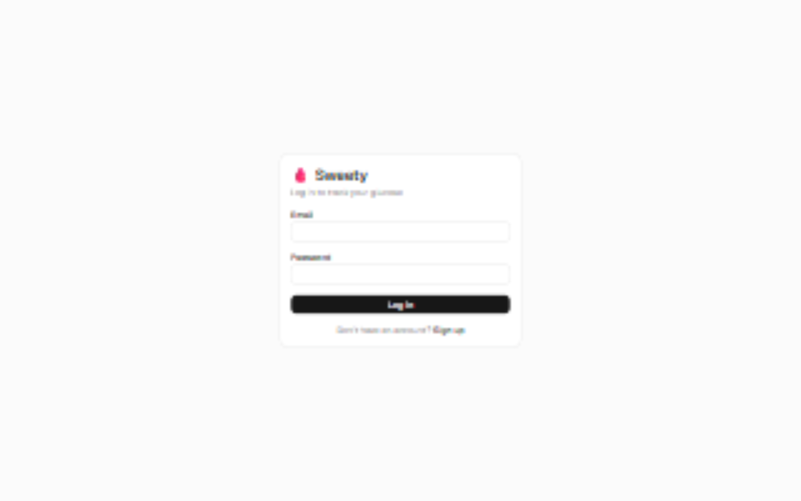
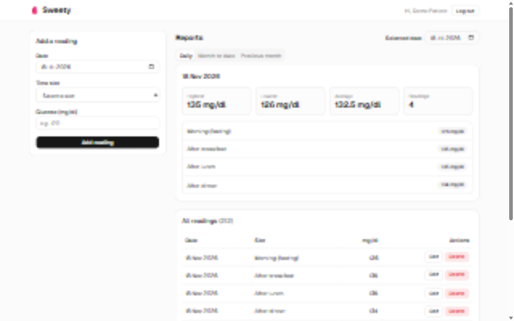
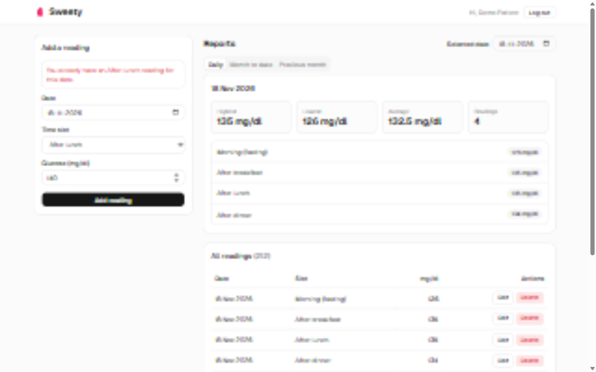
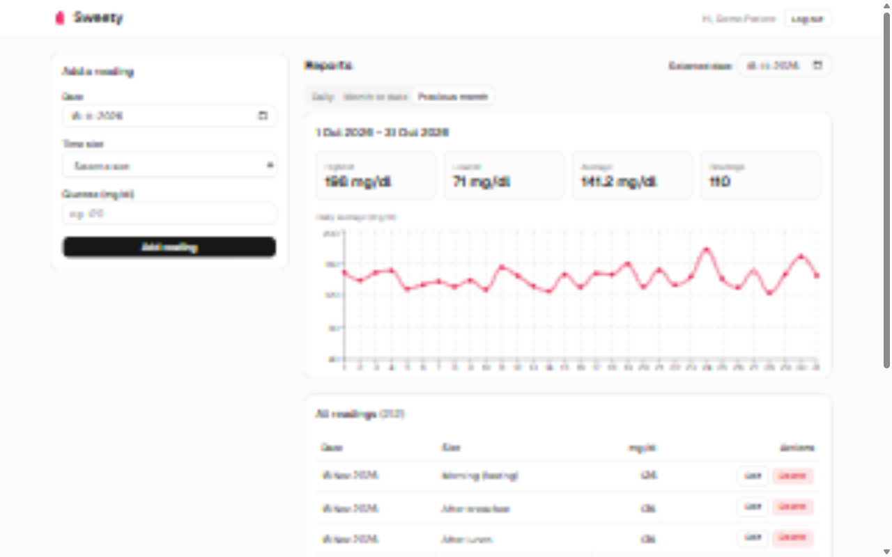

# Sweety – Blood Glucose Tracker

A small web app where a diabetes patient records up to 4 blood glucose readings a day and views daily, month-to-date and monthly reports.

🎥 **Demo video:** [Watch the screen recording](https://drive.google.com/file/d/1kz8-C2MtjxILmyQt3FXGH4xd8Omq7phA/view?usp=sharing)

**Stack:** Node.js + Express · PostgreSQL · React (Vite + TypeScript) · shadcn/ui + Tailwind · Recharts · Jest + Supertest · Vitest + React Testing Library

| Login | Daily report |
| --- | --- |
|  |  |
| **Validation error (duplicate slot)** | **Previous month + chart** |
|  |  |

## Features

- Sign up / log in (passwords hashed with **bcrypt**, JWT auth). Each user only sees their own readings.
- Add, view, edit and delete readings (date, slot, value in mg/dl).
- Validation on both client and server with the exact messages from the spec:
  - "Please enter a glucose value."
  - "Value must be between 40 and 600 mg/dl." (whole numbers only)
  - "You already have an After lunch reading for this date."
  - "You can add only 4 readings per day."
  - "Date cannot be in the future."
- Reports: **Daily**, **Month-to-date**, **Previous month** — highest, lowest, average (1 decimal) and count, with a friendly empty state. The daily report lists each reading with its slot.
- **Bonus:** pagination on `GET /readings`, line chart of daily averages (Recharts), docker-compose for PostgreSQL, React Testing Library tests for the reading form.

## Project structure

```
server/                Express API
  src/db/schema.sql    Tables + constraints
  src/db/migrate.js    Applies the schema
  src/db/seed.js       Demo user + ~2 months of readings
  src/routes/          auth, readings, reports
  src/utils/           validation + date-range helpers (pure, unit tested)
  tests/               unit + API integration tests
client/                React app (Vite + shadcn/ui)
  src/components/      ReadingForm, ReadingsTable, ReportView, ui/ (shadcn)
  src/pages/           AuthPage, Dashboard
docker-compose.yml     PostgreSQL 16 (creates `sweety` and `sweety_test` DBs)
```

## Getting started

**Prerequisites:** Node.js 20+ and either Docker or a local PostgreSQL 14+.

### 1. Install

```bash
cd server && npm install
cd ../client && npm install
```

### 2. Set up the database

With Docker (recommended):

```bash
docker compose up -d db
```

This starts PostgreSQL on `localhost:5432` (user/password `sweety`) and creates two databases: `sweety` (app) and `sweety_test` (tests).

Without Docker, create the two databases yourself:

```sql
CREATE DATABASE sweety;
CREATE DATABASE sweety_test;
```

Then configure and migrate:

```bash
cd server
cp .env.example .env        # edit DATABASE_URL / JWT_SECRET if needed
npm run db:migrate          # creates the tables
npm run db:seed             # optional: demo user with sample readings
```

Demo login after seeding: **demo@sweety.app / demo1234**

### 3. Run

```bash
# terminal 1 – API on http://localhost:4000
cd server && npm run dev

# terminal 2 – web app on http://localhost:5173 (proxies /api to the server)
cd client && npm run dev
```

### 4. Tests

```bash
cd server && npm test      # 33 tests: validation, date ranges, auth, readings, reports (needs the sweety_test DB)
cd client && npm test      # 5 React Testing Library tests for the reading form
```

## Environment variables (`server/.env`)

| Variable | Description |
| --- | --- |
| `PORT` | API port (default `4000`) |
| `DATABASE_URL` | PostgreSQL connection string for the app |
| `TEST_DATABASE_URL` | PostgreSQL connection string used by `npm test` |
| `JWT_SECRET` | Secret used to sign login tokens |
| `JWT_EXPIRES_IN` | Token lifetime (default `7d`) |
| `CLIENT_ORIGIN` | Allowed CORS origin (default `http://localhost:5173`) |

## API

All endpoints except auth need `Authorization: Bearer <token>`.

| Method | Path | Description |
| --- | --- | --- |
| POST | `/api/auth/register` | `{ name, email, password }` → `{ token, user }` |
| POST | `/api/auth/login` | `{ email, password }` → `{ token, user }` |
| GET | `/api/readings?page=1&limit=20&from=&to=` | Paginated list, newest first |
| POST | `/api/readings` | `{ date, slot, value }` |
| PUT | `/api/readings/:id` | Update a reading |
| DELETE | `/api/readings/:id` | Delete a reading |
| GET | `/api/reports/:type?date=YYYY-MM-DD` | `type` = `daily`, `mtd` or `monthly` |

Slots: `MORNING_FASTING`, `AFTER_BREAKFAST`, `AFTER_LUNCH`, `AFTER_DINNER`.

Validation errors return `400` with `{ error: "<message>", errors: { field: "<message>" } }`.

## Notes

### Assumptions

- **"Today"** for the future-date rule is the server's local date (the client checks the browser's local date as well). A production app would store each user's timezone.
- Dates are stored as PostgreSQL `DATE` and handled as `YYYY-MM-DD` strings everywhere, so there are no timezone shifts.
- Since there are exactly 4 slots and one reading per slot per day, the 4-per-day limit is also guaranteed by a `UNIQUE (user_id, reading_date, slot)` constraint. The API still checks the daily count first, so the user gets the clearer message.
- On edit, the reading being edited is excluded from the duplicate-slot and per-day checks.
- "Monthly" means the whole calendar month before the selected date's month (January → previous December).
- Average is rounded in SQL (`ROUND(AVG(value), 1)`). Highest/lowest/average are `null` when there are no readings, and the UI shows an empty state.
- I used `bcryptjs` (a pure-JS bcrypt implementation, same `$2a$` hashes) to avoid native build problems on Windows.
- Passwords need at least 6 characters. Emails are stored in lowercase.
- The JWT is kept in `localStorage` to keep things simple.

### What I would improve with more time

- Move the JWT to an httpOnly cookie and add refresh tokens and rate limiting on login.
- Per-user timezone and a date picker that blocks future dates in every browser.
- Colour-code readings by range (low / normal / high) and add an HbA1c estimate.
- Remaining bonus tasks: Redis report caching, a BullMQ reminder job, a doctor role, and a full `docker compose up` that also runs the API and client.
- End-to-end tests (Playwright) and a CI pipeline.
- Code-split the chart library to reduce the bundle size.
